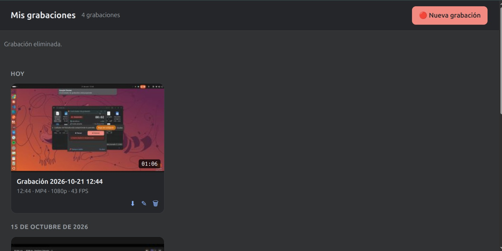

# 👋 Hola, mi nombre es Jose Ahumada

### Full Stack Developer · Asistentes Virtuales · IA Conversacional

[](https://www.linkedin.com/in/jose-ahumada-navarro/)
[](https://github.com/Joseberseker)
[](https://wa.me/573004237458)

Construyo asistentes virtuales de forma práctica: primero en Telegram, después en WhatsApp. Menos humo, más un bot que sí ayude en el día a día. Este repositorio es el código fuente de mi **portafolio web**, donde muestro los proyectos que voy desarrollando a lo largo de mi carrera.

---

## 🧩 Sobre este proyecto

Sitio personal de una sola página (single-page), construido con **React 19** y **Vite**, pensado como vitrina de proyectos, experiencia y contacto directo. Incluye:

- **Hero** con presentación y CTA directo a WhatsApp.
- **Proyectos**: trabajo publicado y roadmap en curso.
- **Sobre mí** y **experiencia** profesional.
- **Contacto** con formulario funcional vía EmailJS.

## 🛠️ Stack técnico


- **React + Vite** — SPA rápida, sin SSR, desplegable como sitio estático.
- **Tailwind CSS 4** (`@tailwindcss/vite`) + CSS propio por componente.
- **Framer Motion** para animaciones de entrada por scroll (`whileInView`).
- **EmailJS** para el envío del formulario de contacto sin backend propio.
- **Boxicons** y **react-icons** para iconografía.

## 📂 Estructura

```
src/
├── main.jsx              # Punto de entrada
├── App.jsx                # Compone las secciones de la página
├── data/
│   └── portfolio.js       # Contenido centralizado: perfil, proyectos, experiencia, skills
└── components/
    ├── pages/              # Una sección por área (Hero, Proyectos, AboutMe, TimeLine, Contact...)
    └── layouts/            # Piezas reutilizables dentro de una sección (ProjectCard, CardTimeLine...)
```

Todo el contenido (bio, proyectos, experiencia, navegación) vive en `src/data/portfolio.js`, así que actualizar el sitio no requiere tocar el JSX.

## 🚀 Puesta en marcha

```bash
git clone https://github.com/Joseberseker/web-portafolio.git
cd web-portafolio
npm install
npm run dev        # servidor de desarrollo (Vite)
```

| Comando | Qué hace |
|---|---|
| `npm run dev` | Levanta el servidor de desarrollo |
| `npm run build` | Build de producción en `dist/` |
| `npm run preview` | Sirve el build de producción en local |
| `npm run lint` | Corre ESLint sobre el proyecto |

## 📌 Proyectos destacados

Además de este portafolio, estos son los proyectos que muestro en la sección **Proyectos** y que ya están publicados:

### 🎥 [Grabador de Pantalla con IA](https://github.com/Joseberseker/grabador-ia)

<a href="https://github.com/Joseberseker/grabador-ia"></a>

Extensión de Chrome (Manifest V3) que graba pantalla, pestaña o ventana, la convierte a **MP4 (H.264 + AAC)** en el propio equipo y transcribe el audio con **Whisper local**. Sin backend, sin subir vídeo ni audio: todo ocurre en el navegador.

### 🤖 [Asistente FAQ con RAG — Telegram + Widget Web](https://github.com/Joseberseker/rag-faq-telegram)

<a href="https://github.com/Joseberseker/rag-faq-telegram"></a>

Asistente de soporte con **RAG 100% local** (Ollama + Chroma, sin APIs pagas) para un e-commerce: responde por **Telegram** y por un **widget de chat embebible**, citando siempre la fuente de la respuesta. Incluye guardrail anti-alucinación de dos capas, memoria de conversación persistente y una evaluación manual documentada con 20 preguntas reales.

El resto de proyectos (API fullstack, dashboard operativo) están en roadmap y se irán sumando con su propia captura a medida que avancen.

## 📬 Contacto

[](mailto:ingeniero.jose.ahumada@gmail.com)
[](https://wa.me/573004237458)
[](https://www.linkedin.com/in/jose-ahumada-navarro/)
